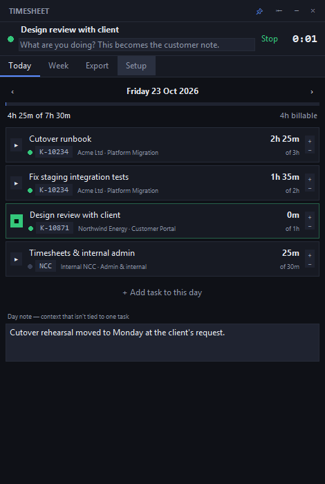
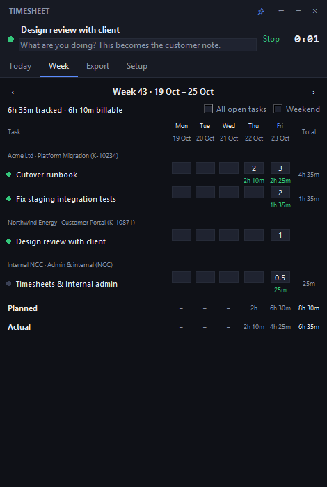
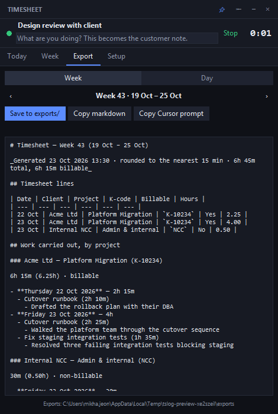
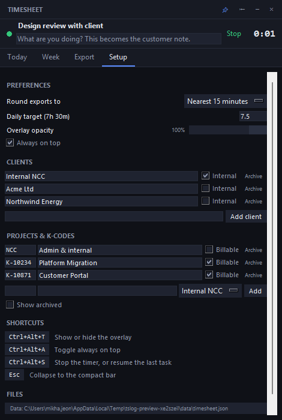

# Timesheet Logger

An always-on-top Windows overlay for planning your week, tracking time against client
projects, and exporting a Markdown summary that Cursor turns into customer-facing
timesheet notes.

```
python run.py          # with a console, for development
pythonw run.pyw        # silent launch, for daily use
```

**No installation, no dependencies.** It runs on the Python standard library alone —
`tkinter` for the UI, `ctypes` for the global hotkeys, `json` for storage. There is
nothing to `pip install`.

| Today | Week |
| --- | --- |
|  |  |

| Export | Setup |
| --- | --- |
|  |  |

## The loop it's built around

1. **Plan** the week in the Week tab — hours per task per day, grouped by client and K-code.
2. **Track** during the day in the Today tab — start/stop timer, or type hours in afterwards.
3. **Export** a week (or a single day) to `exports/2026-W43.md`.
4. **Draft** the customer note by asking Cursor to work from that file. The Export tab has a
   "Copy Cursor prompt" button, and `.cursor/rules/timesheet-note.mdc` tells Cursor the house style.

## Overlay behaviour

| Shortcut | Does |
| --- | --- |
| `Ctrl`+`Alt`+`T` | Show / hide the overlay |
| `Ctrl`+`Alt`+`A` | Toggle always-on-top |
| `Ctrl`+`Alt`+`S` | Stop the running timer, or resume the last task |
| `Esc` | Collapse to the compact bar |

The pin button in the header flips always-on-top, `⇤` widens the window for week planning,
and Setup has an opacity slider for when you want it to sit quietly over whatever you're
working in. Drag it by the header.

Collapsing leaves a thin always-on-top strip showing the running timer — double-click it to
expand. That stands in for a system tray icon, which would have needed a third-party package.

## Data model

- **Client** — may be flagged *internal* (e.g. Internal NCC), which defaults its work to non-billable.
- **Project** — belongs to a client and carries the **K-code** the hours get booked against.
- **Task** — belongs to a project, billable or not.
- **Plan** — intended minutes for a task on a day.
- **Entry** — minutes actually spent, from the timer or typed in, with a note.

Time is always stored to the exact minute. Rounding (default: nearest 15) is applied only
when exporting, so the underlying record stays honest. The export footer always reports the
unrounded total so you can see what rounding did.

## What the export looks like

Two sections do the work. **Timesheet lines** is a table of bookable lines — one row per
K-code per day per billable status, which is exactly how the hours get keyed in:

| Date | Client | Project | K-code | Billable | Hours |
| --- | --- | --- | --- | --- | --- |
| 23 Oct | Acme Ltd | Platform Migration | `K-10234` | Yes | 4.00 |

**Work carried out, by project** is the narrative source, already grouped per K-code the way
a customer note is written, with your task notes nested underneath.

## Where things live

| What | Where |
| --- | --- |
| Your data | `data/timesheet.json` |
| Window position | `data/window.json` |
| Generated notes | `exports/*.md` |

`data/` and `exports/` are gitignored. Delete those lines from `.gitignore` if you'd rather
version-control your history. Set `TIMESHEET_HOME` to put both somewhere else.

A corrupt data file is moved aside rather than overwritten, so a week of tracking is never
lost to one bad write.

## Development

```
python tests\test_smoke.py     # domain logic: dates, store, persistence, export
python tests\gui_smoke.py      # builds every tab and toggles the window states
python scripts\capture_preview.py   # regenerate docs/preview-*.png from sample data
```

`capture_preview.py` runs against throwaway data in a temp folder, so it never touches your
real timesheet.

## Why tkinter rather than Electron or Qt

This was first built on Electron, then attempted on Qt. Neither could be installed on a
Datacom machine:

- **Electron** — `npm install` could not fetch any package. The proxy serves a Zscaler
  click-through caution page for `.gz` downloads, which npm can't answer, so every tarball
  request returned 403. (That is a failed download, not a statement about any package's
  approval status.) Node also needs `NODE_OPTIONS=--use-system-ca` here to trust the
  TLS-inspection root certificate.
- **Qt / PySide6** — downloads fine, but endpoint protection denies loading third-party
  native DLLs from user-writable locations, so `import PySide6` fails with `Access is denied`.

The standard library has none of these problems: it is already installed and already trusted.
See the dependency policy rule for what may be added without approval.
