# Timesheet Logger

An always-on-top Windows overlay for planning your week, tracking time against client
projects, and keying the result into your customer timesheet without retyping anything.

Set up clients, projects and tasks once, then plan and track each day with a timer or typed
hours. Hours come out as the decimal figures timesheet systems ask for, one click from copying.
Windows only, standard-library Python, data kept in a local JSON file.

| Day | Week | Month |
| --- | --- | --- |
| 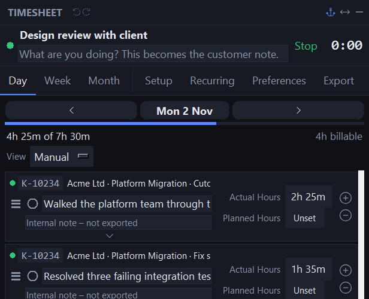 | 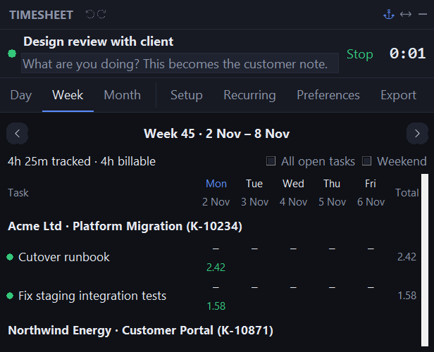 | 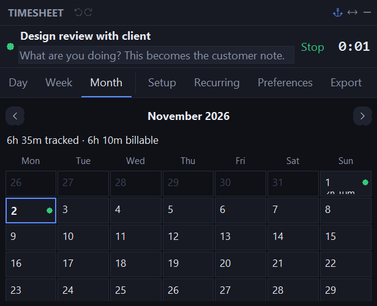 |

| Setup | Recurring | Preferences | Export |
| --- | --- | --- | --- |
| 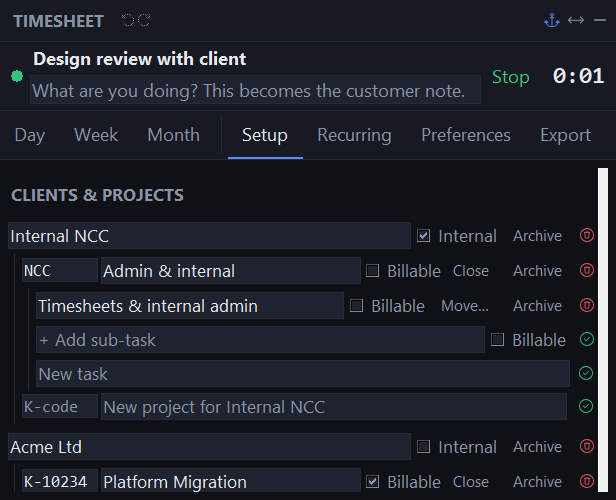 | 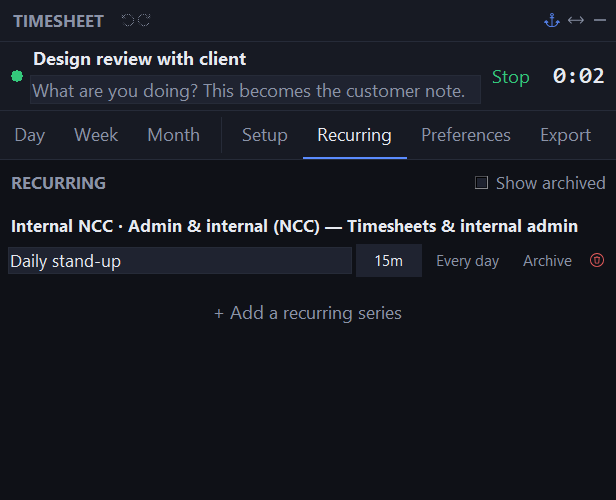 | 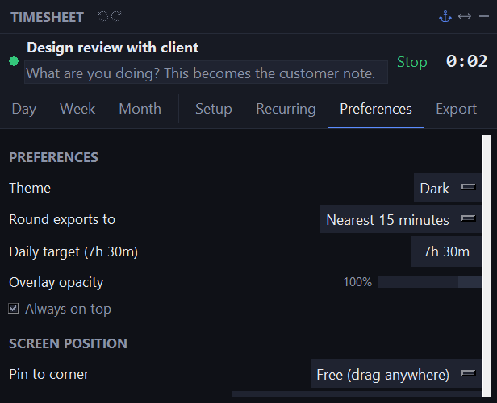 | 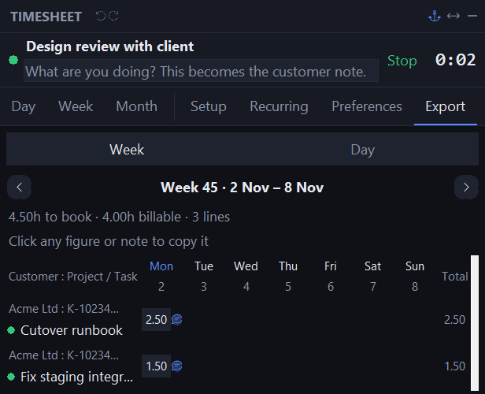 |

## Installation

Download from the [latest release](../../releases/latest). There is nothing to build or `pip install`.

| Option | Use when | Needs |
| --- | --- | --- |
| **`.exe`** | You can run downloaded programs | Nothing |
| **`.zip`** | Your company blocks unknown `.exe` files | Python 3.8+ with tkinter |

**Exe**
1. Download `TimesheetLogger-vX.Y.Z.exe` and double-click it.
2. Windows SmartScreen may warn because it is unsigned: **More info → Run anyway**
   (compare against `SHA256SUMS.txt` if you want to verify it).

**Zip**
1. Download `TimesheetLogger-vX.Y.Z.zip` and unzip it somewhere permanent.
2. Double-click `run.pyw` (or `pythonw run.pyw`; use `python run.py` to see errors).

**Then, for either**
- Open the **Preferences** tab and tick **Start menu shortcut**, then right-click the app in Start
  and choose **Pin to Start**. Also available: **Desktop shortcut** and **Start when I sign in**
  (see [Starting it](#starting-it)).
- Moving the unzipped folder breaks its shortcuts; untick and re-tick them.

**Where your data lives:** the exe keeps it in `%LOCALAPPDATA%\Timesheet Logger`; the zip keeps it in
the unzipped folder's `data/`. To upgrade, replace the exe, or unzip the new version over the old
one (or copy `data/` across). Set `TIMESHEET_HOME` to store it elsewhere.

## The loop it's built around

1. **Set up** the task once in the Setup tab — client, project, K-code, task. The Day tab
   never creates one of these; it only ever picks from what's already there.
2. **See the week at a glance** in the Week tab — decimal hours per task per day, read-only,
   grouped by client and K-code, with what you actually tracked in green underneath. Seven day
   columns in a 565px window is tight, so the left-right arrow in the header steps the window
   through larger sizes for a proper grid — see [Window size](#window-size).
3. **Plan and track** during the day in the Day tab — start/stop timer, type hours in
   afterwards, or just type the note; Planned Hours sits beside it on every row, its own figure
   per entry rather than one shared across a task's whole day. A row is an entry, not a task, so
   what you were actually doing is the first thing on it; see
   [The Day tab: entries, not tasks](#the-day-tab-entries-not-tasks).
4. **Check the month** at a glance in the Month tab — a calendar, for spotting a day that
   slipped past without anything logged.
5. **Book** it in the Export tab — click an hours figure or a note to copy it, paste it into
   the customer timesheet, move to the next line.

Clients, projects, K-codes and tasks live in their own **Setup** tab, separate from the
window and launching preferences — see
[Clients, projects and deleting](#clients-projects-and-deleting). Standing commitments that
come back on their own schedule live in their own **Recurring** tab instead — see
[Recurring notes: work that comes back on its own schedule](#recurring-notes-work-that-comes-back-on-its-own-schedule).

## Overlay behaviour

| Shortcut | Does |
| --- | --- |
| `Ctrl`+`Alt`+`T` | Collapse to the icon, from anywhere |
| `Ctrl`+`Alt`+`A` | Toggle always-on-top |
| `Ctrl`+`Alt`+`S` | Stop the running timer, or resume the last task |
| `Esc` | Collapse to the icon (only while the overlay has focus) |
| `Ctrl`+`Enter` | Add, from anywhere in an add-work, new task, project or client form |
| `Ctrl`+`Z` | Undo the last change |
| `Ctrl`+`Y` / `Ctrl`+`Shift`+`Z` | Redo |

The first three are global hotkeys, changeable from the Shortcuts section of the Preferences
tab — click one, press a new combo (it needs a `Ctrl`, `Alt` or `Shift` in it), and it takes
effect immediately. A **Reset** button appears next to any shortcut you've changed, to put it
back the way it came.

The pin button in the header flips always-on-top, the left-right arrow steps the window through
larger sizes — see [Window size](#window-size) — and the hyphen button beside it, styled after
Windows' own minimize glyph, collapses it to the badge below. There's no close button among them;
quitting for good is the tray icon's job alone — see [Starting it](#starting-it). Preferences has
an opacity slider for when you want it to sit quietly over whatever you're working in. Drag it by
the header.

The two curved arrows beside the TIMESHEET label are Undo and Redo — greyed out when there's
nothing to step to. They walk back whatever you've logged, planned or set up (entries, tasks,
projects, clients, recurring notes...); window position, theme and other preferences aren't part
of that history, so undoing an edit never also reverts a setting you changed in between. The
history is session-only and doesn't survive closing the app.

## Window size

The left-right arrow in the header cycles the window through three sizes, wrapping back to the
first once it's been round them all:

| Size | Dimensions |
| --- | --- |
| Small (the default) | 565×500, fixed |
| Quarter | half the screen's width, half its height |
| Half | half the screen's width, the full height |

"Screen" means whichever monitor the window is currently snapped to in Preferences (the primary
one, if it's set to free placement) — sizing is worked out fresh each time the button is
pressed, so it still lands correctly after a monitor is unplugged or swapped for a different
size. The icon flips to point the other way once the cycle reaches Half, as a hint that the next
click takes it back down to Small rather than further out.

**Screen position** in Preferences pins the overlay to any corner of any monitor. Connected
screens are detected through Win32 `EnumDisplayMonitors`, so a second monitor shows up in
the picker within a few seconds of being plugged in — and the overlay follows its corner
when screens are rearranged or unplugged. Corners are measured off the *work area*, so the
taskbar is never covered. While it's pinned the header no longer drags the window — set the
corner back to **Free** to move it by hand.

Collapsing shrinks the window to a 46px always-on-top badge. Double-click it to expand,
drag it to move it. That stands in for a system tray icon, which would have needed a
third-party package. A green lamp in the corner means a timer is running. Snapped to a
corner, the badge sits a few pixels off the edge rather than flush against it like the
expanded window does — small and square enough to read as a free-floating icon, like a
desktop shortcut, rather than as chrome docked out of the way.

Tk can't round off a widget, and clipping the window to a rounded region draws the corners
stepped — so the badge asks Windows to round the *window*, through `DwmSetWindowAttribute`
in `timesheet/dwm.py`. The hairline border comes from DWM too, since it's the only one that
follows the arcs; that's also what turns it green. Both attributes need Windows 11, and the
calls are best-effort: where they're refused the badge keeps Tk's square border.

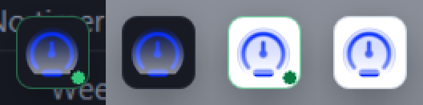

## Starting it

The Preferences tab writes its own shortcuts, so there's nothing to run by hand after the
first time.

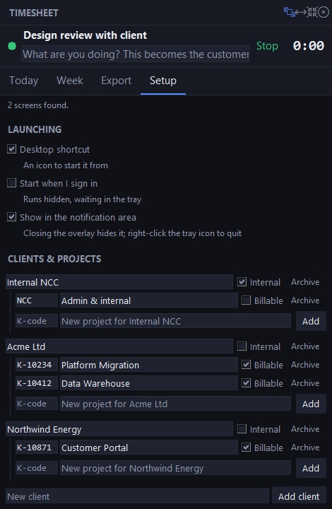

- **Start menu shortcut** lists it in Start's app list, from where it can be pinned.
- **Desktop shortcut** puts `Timesheet Logger.lnk` on your desktop, pointing at `pythonw.exe`
  and `run.pyw` with the app icon on it.
- **Start when I sign in** puts the same shortcut in your Startup folder. It opens silently
  and waits in the notification area.
- **Show in the notification area** puts a clock icon in the tray. Left-click shows and
  hides the overlay; right-click offers Show, start or stop the timer, and Quit. Hovering it
  reports the running task and its elapsed time, which is the only way to read the clock
  while the overlay is hidden.

There's no close button anywhere in the app — quitting for good is **Quit** on the tray menu
alone. With a tray icon there's always a way back, so an OS-level close (Alt+F4, or "Close
window" from the taskbar) just hides the overlay rather than exiting it. Untick the tray and
that same close quits instead, rather than leaving the app somewhere you can't reach.

Both boxes report what's actually on disk, so deleting a shortcut by hand unticks it. The
desktop folder is looked up from Windows rather than assumed to be `~/Desktop`, because
OneDrive moves it.

Only one instance runs at a time. Starting it again — by hand, from the desktop shortcut, or
because both "Start when I sign in" and a manual launch land at once — finds the one already
up and brings it to the front instead of opening a second overlay on the same data.

> Windows 11 hides new tray icons in the overflow arrow by default. Drag it onto the taskbar
> once, or turn it on under Settings → Personalisation → Taskbar → Other system tray icons.

Shortcuts point at this folder. Move the project and you'll need to re-tick the boxes.

## Theming

Two palettes ship — dark by default, light under **Theme** in Preferences — plus a **System**
option that tracks Windows' own light/dark setting (read from the registry, polled for live
changes) rather than naming a palette directly. Switching is live. Tk writes colours onto a
widget when it's created and never re-reads them, so there's no repainting in place: the
overlay rebuilds its widget tree on the spot instead.

| Dark | Light |
| --- | --- |
|  | 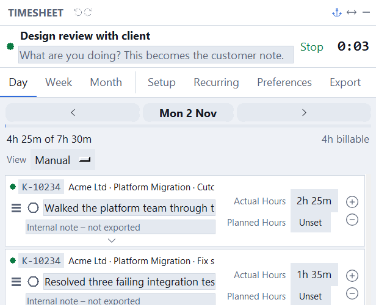 |

Every colour lives in `timesheet/ui/theme.py` as a role-named token — `BG_RAISED`, `MUTED`,
`ON_ACCENT`, `BILLABLE`, `RUNNING_LINE` — next to the widget factories each view builds
through (`theme.button`, `theme.entry`, `theme.pill`, and the rest). A third palette is one
more dict in `PALETTES` and no view changes at all, because the tokens are module attributes
read at the moment a widget is built rather than constants captured at import.

### Icons

Buttons carry real icons rather than text glyphs, taken from the Datacom design folder. Tk
can't read SVG and nothing that converts it is installed, so `scripts/build_icons.py` drives
headless Chrome to rasterise each one into `timesheet/ui/icons/{dark,light}/`. Those PNGs
are committed, so running the app needs neither Chrome nor the design folder.

Two kinds, from the two source folders. **Functional** icons are single-path line drawings,
rendered at the exact pixel size and palette colour each one is used at — the window
chrome, the nav arrows, the row buttons. The **hi-fi** illustration on the collapsed badge
is full colour with its own gradients, so it's rendered as drawn and the same PNG serves
both palettes. That's why the badge shows a timer running with a lamp in the corner rather
than by turning green: there's nothing to recolour.

Views ask for icons by role through `timesheet/ui/icons.py` (`icons.button`, `icons.label`,
`icons.swap`), which picks the file matching the active palette. Every call takes a
`fallback` character, so a checkout whose PNGs haven't been generated still runs with its
buttons labelled. To change or add one, edit the `ICONS` map in `scripts/build_icons.py`
and re-run it.

The same script also packs `icons/app.ico` — the hi-fi illustration centred on a square
canvas at the eight sizes Windows asks for, written as PNG-compressed ICO entries. That's
the icon the tray, the taskbar and both shortcuts use.

## Data model

- **Client** — may be flagged *internal* (e.g. Internal NCC), which defaults its work to non-billable.
- **Project** — belongs to a client and carries the **K-code** the hours get booked against.
  May be **closed** — see [Clients, projects and deleting](#clients-projects-and-deleting).
- **Task** — belongs to a project, billable or not, and may nest one level under another task —
  see [Phases: nesting a task one level deep](#phases-nesting-a-task-one-level-deep).
- **Plan** — intended minutes for a task on a day, before anything's logged against it yet;
  optionally carries its own note. Once an entry exists, Planned Hours moves onto it instead
  (see **Entry** below) — a Plan only ever covers the gap before that.
- **Recurrence** — a rule on a recurring note that plans it on days you never typed.
- **RecurringNote** — a note with its own recurrence rule, under a shared task — several standing
  commitments can share one billing bucket this way; see
  [Recurring notes: work that comes back on its own schedule](#recurring-notes-work-that-comes-back-on-its-own-schedule).
- **Entry** — minutes actually spent, from the timer or typed in, with a note, and its own
  Planned Hours — independent of every other entry the same task may also have logged the same
  day. The Day tab shows one row per entry, not per task — see
  [The Day tab: entries, not tasks](#the-day-tab-entries-not-tasks).

Time is always stored to the exact minute. Rounding (default: nearest 15) is applied only
when exporting, so the underlying record stays honest. The export footer always reports the
unrounded total so you can see what rounding did.

## Clients, projects and deleting

The Setup tab is where clients, projects, K-codes and tasks get managed — kept apart from
window behaviour and shortcuts (that's Preferences now) because this list is the one that
grows.

**Billable** is set per project and, underneath that, per task. Turning a project's own
**Billable** box off hides the per-task choice everywhere that task shows up — it isn't
offering something the project has already ruled out. The task's own flag is never
overwritten by this: switch the project back on and whatever each task already said comes
straight back, nothing to retype.

**Deleting** a client, project or task takes two clicks: the trash icon arms into a
confirm/deny pair rather than acting on the first click. It's refused, bottom-up, wherever
there's something that depends on it:

- A **task** with logged time, a plan, a recurring note, or a running timer won't delete —
  that's exactly the record **Archive** exists to keep instead.
- A **project** won't delete while it still has tasks under it, archived or not.
- A **client** won't delete while it still has projects under it.

Clear the reason and the same click goes through. Archiving stays the everyday way to retire
something that's been used; deleting is for undoing something that shouldn't have been added
in the first place.

**Close** on a project is the K-code-level version of wrapping work up, confirmed with a modal
first since it reaches further than Archive does: every task under it drops out of the Week
tab's **All open tasks** and the Recurring tab's task picker, and stops generating new
recurring-note occurrences. Nothing already logged is touched, and **Reopen** undoes it with
no guard, since nothing's at risk the second time.

Adding something — a task, a project, a client — is confirmed with a green check or
cancelled with a red cross, the same small rounded chip either way.

## Phases: nesting a task one level deep

A task picks up a **Phase** label — never stored, always computed — the instant it gains its
own child task in the Setup tab's **+ Add sub-task** row. Lose the last child and the label
drops away again just as silently.

- Nesting stops at one level: a child task never gets a **+ Add sub-task** of its own.
- A task doesn't have to be *clean* to gain its first child — logged time, a plan, or a
  recurring note already on it moves onto the new child in the same step, automatically,
  rather than being refused or left behind. That's because a Phase is never directly loggable:
  once a task has children, only *they* show up in the Day and Week tabs, the add-work picker,
  and the Export tab — prefixed with the Phase's own name, e.g.
  `Cutover runbook › Draft the rollback plan` — so anything still sitting directly on the task
  itself would otherwise quietly vanish the moment it became one.
- **Move...** on any task row relocates its logged time, plan and recurring note onto another
  task by hand, the same way gaining a child does it automatically — for consolidating two
  tasks' history, or fixing time logged against the wrong one. A plan already on the
  destination for the same day isn't overwritten: its minutes and the moved plan's add together.
- Deleting a Phase is refused while it still has children, the same bottom-up guard as a
  project with tasks under it.

## The Day tab: entries, not tasks

A row on the Day tab is an **entry** — or, before anything's logged yet, a stand-in for the
task's plan — not a task. The thing worth typing most days is what the time actually was, so
that note is the prominent text on every row; the task (and its Phase, and its project) sits
underneath as a metadata line instead, the way the K-code pill already did.

- **Logging more than one stint** against the same task on the same day gets its own row —
  "+ log another entry" beneath the last one — rather than folding a second note into the first.
  It starts at **0m**, left for its own Actual Hours picker to fill in.
- **Creating work** is always "pick an existing task", never "make a new one": that's the Setup
  tab's job now. The **+ Add task to this day** panel picks a task, takes an optional note, and
  sets how long it's planned for — **Unset** until you say otherwise, rather than a guessed
  figure.
- **Actual Hours** and **Planned Hours** sit side by side on the right of every row, each under
  its own label and lined up one above the other so the two are easy to compare at a glance.
  Both are always editable — Actual Hours is a live-ticking figure instead on whichever row the
  timer's running. Planned Hours is each entry's own: logging two stints against the same task
  the same day gives each its own figure, **Unset** by default, rather than sharing one between
  them. Before anything's logged, the one placeholder row still reflects the task's day-level
  plan instead, since there's no specific entry yet for a figure to belong to.
- **+** and **−** sit stacked at the card's own right edge, past Actual/Planned Hours, nudging
  the entry's time by 15 minutes each way. Nudging down floors at 0m rather than deleting the
  entry — that's the **×** chip's job, below, with its own confirmation.
- A small **▾ / ▴** arrow sits centred at the bottom of every card — click it (or the row's own
  text above) to expand or collapse that row's detail panel.
- That detail panel also holds an **internal note** — a five-row box for anything worth
  remembering (client context, a risk, what's next) that should never reach an export. It's
  separate from the row's own note above, which `bookings.collect` reads and the Export tab
  shows; this one is never part of either.
- **×**, which dismisses a row outright (with a confirmation modal once there's real time logged
  against it), lives on that expanded detail panel now, top-right, on the same line as the
  **Repeat** checkbox — see [Recurring notes](#recurring-notes-work-that-comes-back-on-its-own-schedule)
  below.
- **View** switches how rows are arranged: **Manual** (the default) is a flat, drag-reordered
  list — grab the handle on the left of a row and drop it where it belongs, remembered per day.
  **By Project**, **By Phase** and **By Task** group rows under a heading instead, merging a
  Phase's children together or keeping every task on its own line, and don't drag.

## Recurring notes: work that comes back on its own schedule

Expand any row on the Day tab and tick **Repeat** to have it plan itself from here on — that
row, specifically, not the task as a whole. The first time it's ticked on a row, it creates a
**recurring note**: a standing commitment, tied to this task for billing but with its own
words and its own schedule, independent of anything else logged against the same task. Tick
it on a different row later — another entry, another day — and that row gets a second note of
its own; nothing about the first is touched.

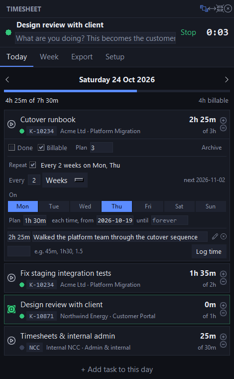

The editor is a sentence that grows: pick days, weeks or months and only the controls that
frequency needs appear.

- **Days** — every day, or every *n*th.
- **Weeks** — every *n* weeks, on whichever weekdays you tick. Ticking Mon and Thu on a
  2-week rule gives you both days in the same fortnight, not alternating ones.
- **Months** — every *n* months, on whichever dates you tick, optionally narrowed to
  particular months. That's how you set a date pattern for the whole year: tick 1 and 15,
  then tick Jan, Apr, Jul and Oct.

**Last** covers month ends, because not every month has a 31st. A date a month is too short
for is skipped rather than nudged to the 28th — if you meant the end of the month, say so
with **Last**.

Nothing is written out in advance. The rule is matched against each day as it's drawn, so
editing it moves every future occurrence at once and days you've already booked are left
exactly as they were. Typing a figure over a day a note is due pins that one day; clearing it
to zero skips just that occurrence and leaves the rest of the note's schedule alone.

Several standing commitments can share one task's billing bucket this way — a daily stand-up
and a Monday admin slot might both belong under the same K-code, each needing its own days
and its own wording, without opening two tasks just to tell them apart on the timesheet. Every
recurring note across every task is also listed, live, on its own **Recurring** tab, rather
than under the task in Setup — a standing commitment is an ongoing pattern of logging, not
part of a project's structure, so it gets a tab closer in kind to the Day tab than to the
client/project/task tree. **+ Add a recurring series** there works the same way, just starting
from the task instead of from a row already on the Day tab: it picks the task the note bills
against, and the Repeat editor is already open and ticked on — a sensible weekly guess from
today — so the schedule is set at the same moment the note is, not as a second step afterwards.
Each note then shows up as its own row on the Day tab on the days it's due, independently of
any others sharing the task.

- Logging one note's occurrence — typing a duration, nudging it, or starting its timer — only
  retires its own row for the day. A sibling note due the same day keeps its own, still pending.
- Once a note's occurrence becomes a real entry, Planned Hours moves onto it like any other
  entry — **Unset** to start, independent of whatever the note's own usual duration was, or of
  any other entry the task has that day. A note still pending shows its usual duration instead,
  as a read-only hint rather than a live field.
- A task hosting a recurring note can still pick up a **+ Add sub-task** of its own in the
  Setup tab — the note moves onto the new child along with any logged time or plan, the same
  as the rest of the task's history; see
  [Phases: nesting a task one level deep](#phases-nesting-a-task-one-level-deep). The Recurring
  tab is where to look for it afterwards, since it now belongs to the child instead.
- **Archive** on the Recurring tab stops a note being suggested on future days without losing
  it or the entries it already produced — toggle **Show archived** to find it again. Deleting a
  note is a single step, no guard beyond that: unlike a task, there's no history directly on it
  to protect — every entry it's already produced stands on its own, untouched.

## Seeing the month

The Month tab is a calendar: always seven full days a row, whatever **Weekend** is set to in
Week, since a calendar with a day missing reads oddly. Each cell shows the date, what got
tracked that day, and a dot for whether most of it was billable; today is outlined in the
accent colour. Click a day to jump straight into it on the Day tab — the Month tab is for
finding a day, not for working inside one cell of it. There's no "vs target" figure here,
unlike Day and Week, because nothing in the app models a monthly target to measure against.

## Booking the hours

The Export tab is a click-to-copy table, built for sitting next to the customer timesheet
and filling it in field by field. Pick a week (or a single day) with the arrows — past weeks
included — and every row is **one task on one day**: the hours figure on the right, the note
underneath. Click either and it goes on the clipboard, ready to paste.

Several entries against the same task in the same day are rolled into one row, because
that's how they get booked: the minutes are added together and the notes joined into a
single line separated by ` | `, which is what a one-line comments field wants.

> `Ran the staging cutover with their DBA | Signed the runbook off with ops`

Hours are the decimal figure timesheet systems ask for (`2.25`, not `2h 15m`), rounded by
the increment set in Preferences. A repeated note within a day is only included once.

**Copy whole table** puts the lot on the clipboard as tab-separated text, so it pastes into
Excel or Sheets as a real grid. **Save to exports/** writes `exports/2026-W43.md`, a
Markdown record of the period with the narrative grouped per K-code.

## Where things live

| What | Where |
| --- | --- |
| Your data | `data/timesheet.json` |
| Window position | `data/window.json` |
| Saved period records | `exports/*.md` |
| Desktop shortcut | your Desktop folder, as Windows reports it |
| Sign-in shortcut | `%APPDATA%\Microsoft\Windows\Start Menu\Programs\Startup` |

`data/` and `exports/` are gitignored. Delete those lines from `.gitignore` if you'd rather
version-control your history. Set `TIMESHEET_HOME` to put both somewhere else.

A corrupt data file is moved aside rather than overwritten, so a week of tracking is never
lost to one bad write.

## Development

```
python tests\test_smoke.py     # domain logic: dates, store, persistence, export
python tests\gui_smoke.py      # builds every tab and toggles the window states
python scripts\capture_preview.py   # regenerate docs/preview-*.png from sample data
```

`capture_preview.py` runs against throwaway data in a temp folder, so it never touches your
real timesheet.

## Why tkinter rather than Electron or Qt

This was first built on Electron, then attempted on Qt. Neither could be installed on a
Datacom machine:

- **Electron** — `npm install` could not fetch any package. The proxy serves a Zscaler
  click-through caution page for `.gz` downloads, which npm can't answer, so every tarball
  request returned 403. (That is a failed download, not a statement about any package's
  approval status.) Node also needs `NODE_OPTIONS=--use-system-ca` here to trust the
  TLS-inspection root certificate.
- **Qt / PySide6** — downloads fine, but endpoint protection denies loading third-party
  native DLLs from user-writable locations, so `import PySide6` fails with `Access is denied`.

The standard library has none of these problems: it is already installed and already trusted.
See the dependency policy rule for what may be added without approval.
